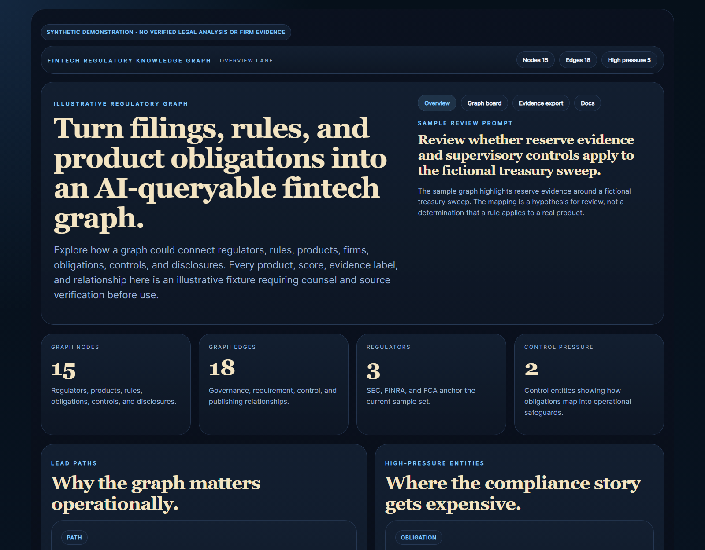
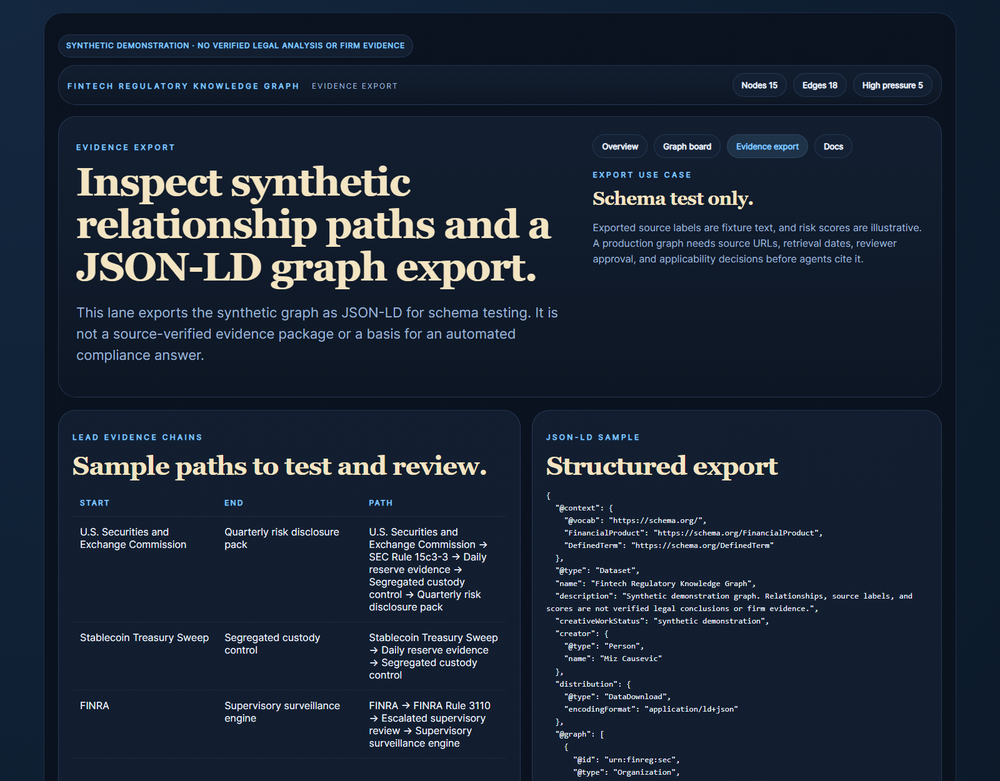
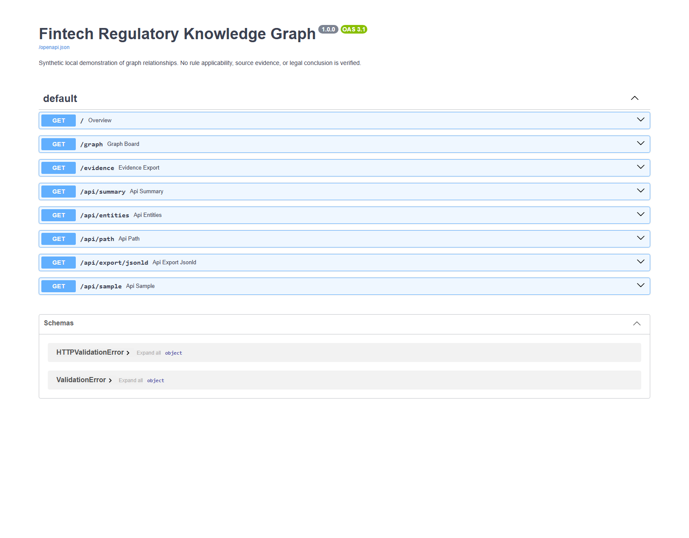

# Fintech Regulatory Knowledge Graph

Knowledge graph for fintech regulatory entities, obligations, disclosures, and AI-queryable compliance context.

> **Synthetic demonstration.** The 15 nodes, 18 relationships, firm, products, source-document labels, risk scores, and review prompt are illustrative fixtures. This repo does not ingest filings, verify rule applicability, hold firm evidence, or provide legal advice. Do not use its paths or JSON-LD as a compliance determination. Production use needs current primary-source URLs, retrieval dates, jurisdiction and product applicability review, reviewer approval, and a correction path.

## Why this repo is good

- It turns fintech compliance into a structured entity problem instead of a document pile.
- It connects regulators, rules, products, obligations, controls, and disclosures in one traversable model.
- It exports JSON-LD so downstream AI systems can consume machine-readable compliance context.
- It complements `payment-event-ledger-eos`, `pulumi-pci-dss-baseline`, and `otel-fraud-signal-tracer` as part of a stronger fintech cluster.

## Screenshots






## What it does

- seeds a synthetic local graph of regulators, rules, firms, products, obligations, controls, and disclosures
- exposes graph summaries and entity filters through FastAPI routes
- resolves explainable relationship paths between high-risk products and control evidence
- exports the graph as JSON-LD for AI-queryable compliance context
- presents a polished HTML proof surface for overview, graph board, and evidence export

## Local run

```powershell
cd fintech-regulatory-knowledge-graph
py -3.11 -m pip install -r requirements.txt
py -3.11 -m app.main
```

Open:

- `http://127.0.0.1:4591/`
- `http://127.0.0.1:4591/graph`
- `http://127.0.0.1:4591/evidence`
- `http://127.0.0.1:4591/docs`

If the port is busy:

```powershell
$env:PORT = "4595"
py -3.11 -m app.main
```

## Validation

```powershell
py -3.11 -m pip install -r requirements.txt
py -3.11 -m pytest tests
py -3.11 scripts\run_demo.py
```

## API routes

- `GET /api/summary`
- `GET /api/entities?node_type=regulator`
- `GET /api/path?start=sec&end=risk-disclosure-pack`
- `GET /api/export/jsonld`
- `GET /api/sample`

## Source starting points

The rule names in the fixture can be checked against the [eCFR customer protection rule](https://www.ecfr.gov/current/title-17/chapter-II/part-240/section-240.15c3-3), [FINRA Rule 3110](https://www.finra.org/rules-guidance/rulebooks/finra-rules/3110), and [FCA Consumer Duty PRIN 2A](https://handbook.fca.org.uk/handbook/PRIN/2A/). These primary texts were accessed on 2026-09-29. Their presence here does **not** verify any fictional product-to-rule edge, control sufficiency, source-document label, or score. In particular, a fictional stablecoin treasury sweep must not be treated as an established customer-protection-rule sweep program.

## Repo anatomy

- [app/main.py](./app/main.py)
- [app/models.py](./app/models.py)
- [app/data/sample_graph.py](./app/data/sample_graph.py)
- [app/services/graph_service.py](./app/services/graph_service.py)
- [docs/architecture.md](./docs/architecture.md)
